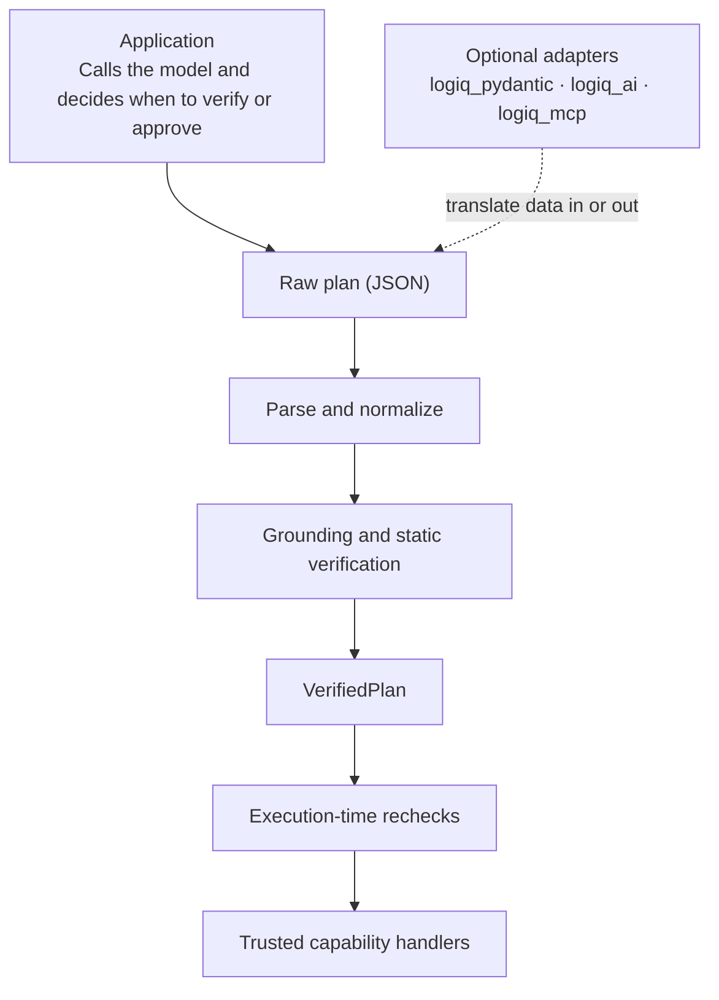

Architecture
Logiq verifies a plan before allowing it to run. This document explains the main components and why they exist.

For the full execution pipeline, see [`system-design.md`](system-design.md).
Core guarantee
A plan that fails Logiq's required verification checks does not reach normal handler execution.

The core is designed to make this guarantee testable.
Component map

The core (src/logiq/) owns the trust boundary. Optional adapters translate data in or out; they must not call the verifier or executor or construct a VerifiedPlan (ADR-0006 and ADR-0007).
Core components
engine.py — coordinates the pipeline
Logix connects the registry, policies, invariants, grounding rules, idempotency store, and tool catalog.
- logix.capability supports decorator and registry access patterns.
- logix.verify(plan) parses and verifies a plan. It returns a VerificationReport.
- logix.execute(verified_plan) executes only a VerifiedPlan.
- logix.run(plan) uses the same verify-then-execute pipeline; it has no bypass.
capabilities.py — registered actions
A Capability describes an action, its handler, input and output schemas, effects, approval requirements, and idempotency behavior.

Capabilities are created by build_capability, which inspects annotations and infers schemas. Unsupported annotations fail at registration (ADR-0003).

Registry is the source of truth for callable capabilities. Unknown names raise KeyError; Logiq does not fall back to Python attribute lookup. A stable snapshot hash lets the executor detect registry changes after verification.
annotation_inspect.py — function signatures
Reads a function's signature, docstring, and resolved annotations. It rejects unsupported function shapes, including non-callables, classes, async functions, variadic parameters, and unbound methods.
schemas/ — types and validation
Module	Responsibility
types.py	Defines schema types such as integers, strings, objects, unions, literals, lists, and dictionaries. Validation is strict: no coercion, bool is not int, and int is not float.
infer.py	Converts Python annotations into input and output schemas. Unsupported annotations raise SchemaInferenceError.
constraints.py	Defines Annotated constraints such as Gt, Ge, Lt, Le, MinLength, MaxLength, and Pattern.
validate.py	Validates capability inputs and outputs, including constrained values.
json_schema.py	Converts the same schema types to JSON Schema, keeping runtime validation and AI-facing schemas consistent.
unsupported.py	Describes unsupported annotations so Logiq can reject them instead of weakening validation.

The schema Type protocol provides validate(value, path), to_json_schema(), and walk(segment). walk supports checking references to fields in nested schemas.
plans/ — plan parsing and references
Module	Responsibility
parse.py	Converts an untrusted dictionary or JSON string into a CanonicalPlan. Checks structure, version, size limits, and references.
references.py	Defines and resolves the small $ref format: {"$ref": "<step-id>[.<segment>]*"}. It supports no wildcards, expressions, or functions.
limits.py	Defines limits for bytes, steps, depth, and invocations.
format.py	Provides plan-version helpers and a reserved plan builder.

A step may reference only an earlier step, so normal parsing prevents cycles. The parser returns a CanonicalPlan or a list of errors; it does not raise. See [`plan-format.md`](plan-format.md).
verifier.py — checks before execution
verify_plan(...) checks that:
1. Every capability exists.
2. Every input matches its schema.
3. Each $ref points to a field with a type assignable to the destination. For example, int is not widened to float.
4. Dependencies can be ordered safely.
5. The dependency graph has no cycles.
6. The registry snapshot is recorded for execution-time comparison.
On success, it returns a VerifiedPlan and no errors. On failure, it returns errors. It never calls a handler.
ir.py — verified plans
VerifiedPlan is a frozen representation created through a private constructor, not ordinary direct construction. It stores the plan version, verified steps, dependency order, capability snapshot hash, verification hash, and whether the plan is a single call.

The verification hash binds the plan, dependency order, and registry snapshot together (ADR-0002).
executor.py — controlled execution
The executor is the only component that invokes handlers. For each step, it:
1. Rejects values that are not VerifiedPlan instances.
2. Checks that the registry has not changed since verification.
3. Resolves references using validated outputs from earlier steps.
4. Rechecks live conditions immediately before the handler call.
5. Returns cached results for idempotent replays.
6. Stops when approval is required or the action is denied.
7. Prepares arguments, calls the handler, validates and normalizes its output, and records idempotency state.
It records a trace and invokes the audit hook for each step and for the overall result. Results contain either a value or errors, plus the trace. A single-call plan returns the handler value; a multi-step plan returns a mapping of step IDs to outputs.

Checks that depend on changing state—such as invariants, approval, idempotency, and refreshed context—run immediately before the handler call. See [`semantic-layer.md`](semantic-layer.md) and ADR-0004.
context.py, policies.py, and approval.py — execution decisions
- ExecutionContext is frozen, and its extra mapping is read-only. The application supplies it; the AI does not.
- Allow, Deny, and RequireApproval represent invariant decisions.
- ApprovalToken is bound to the capability, argument hash, principal, and context hash. It must match all of them; tokens are issued by application code.
results.py and errors.py — outcomes
- Result requires successful results to have no errors and failed results to have at least one.
- VerificationReport requires successful reports to contain a VerifiedPlan and failed reports not to contain one.
- Error accepts only codes in the stable ALL_CODES taxonomy. Adding a code is a minor release; renaming or removing one is a major release.
semantic/ — checks involving meaning or live state
This package contains grounding, invariants, execution-time rechecks, repair loops, and idempotency. See [`semantic-layer.md`](semantic-layer.md).
_internal/ — immutability and redaction
- immutability.py provides freezing and canonical JSON/hash helpers used for tamper detection.
- redaction.py provides redact for applications that include sensitive values in their own error details. Logiq's built-in traces and errors avoid raw values by construction.
Design principles
1. Verify before calling handlers
@logix.capability returns the original function. logix.run(plan) verifies the plan before executing it, so invalid plans do not cause handler side effects.
2. One execution path
Single-call and multi-step plans use the same parser, verifier, and executor. Single-call plans use a synthetic __single__ step ID. There is no shortcut around verification.
3. Reject unsupported input
Logiq rejects input it cannot safely understand instead of silently weakening validation. Examples include unsupported Python annotations, unsupported MCP JSON Schema keywords, and unknown top-level plan fields. See ADR-0003.
4. Verification is not authorization
A VerifiedPlan records that a plan passed structural and static checks at verification time. It does not guarantee that the caller is still authorized or that live conditions and approvals remain valid. The executor checks those conditions again immediately before execution (ADR-0004).
5. Adapters stay outside the trust boundary
logiq_pydantic, logiq_ai, and logiq_mcp translate data in or out. They must not access the verifier, executor, verified-plan representation, or internal security helpers (ADR-0006 and ADR-0007).
6. Provider-neutral core
The core can produce a neutral JSON Schema catalog with tools.format("json"). Optional provider-specific formats translate that catalog for particular AI providers. The trust boundary does not depend on which model produced a plan. See [`ai-integration.md`](ai-integration.md).
7. No third-party runtime dependencies in the core
Importing logiq uses only the Python standard library. Optional packages load their dependencies only when imported. Tests check that the core works without Pydantic or MCP installed.
8. Data types enforce their own rules
Result, VerificationReport, Error, and VerifiedPlan enforce their invariants when created. Consumers do not need to repeat the same checks everywhere.
What stays outside the core?
Concern	Where it belongs	Why
Model calls	Application	The application owns the provider and decides when to call it.
HTTP servers	Application or logiq_mcp	The core is transport-independent.
Persistent storage	Application or an IdempotencyStore implementation	The default store is in memory; applications choose durable storage.
Prompt engineering	Application or logiq_ai.prompt_json_mode	Prompts guide a model; they do not replace verification.
Retry policy	Application or semantic.repair_loop	Applications choose whether and how to retry.
Business rules	Application	Logiq runs the rules the application declares.
Audit storage	Application, using logix.audit(hook)	Logiq provides audit metadata; the application chooses where to store it.

Related documentation
- [`system-design.md`](system-design.md) — execution pipeline and guarantee-to-test mapping.
- [`security.md`](security.md) — threat model and security test checklist.
- [`plan-format.md`](plan-format.md) — plan JSON grammar.
- [`schemas.md`](schemas.md) — schema engine details.
- [`semantic-layer.md`](semantic-layer.md) — grounding, invariants, approval, and idempotency.
- [`adr/`](adr/) — architecture decision records.